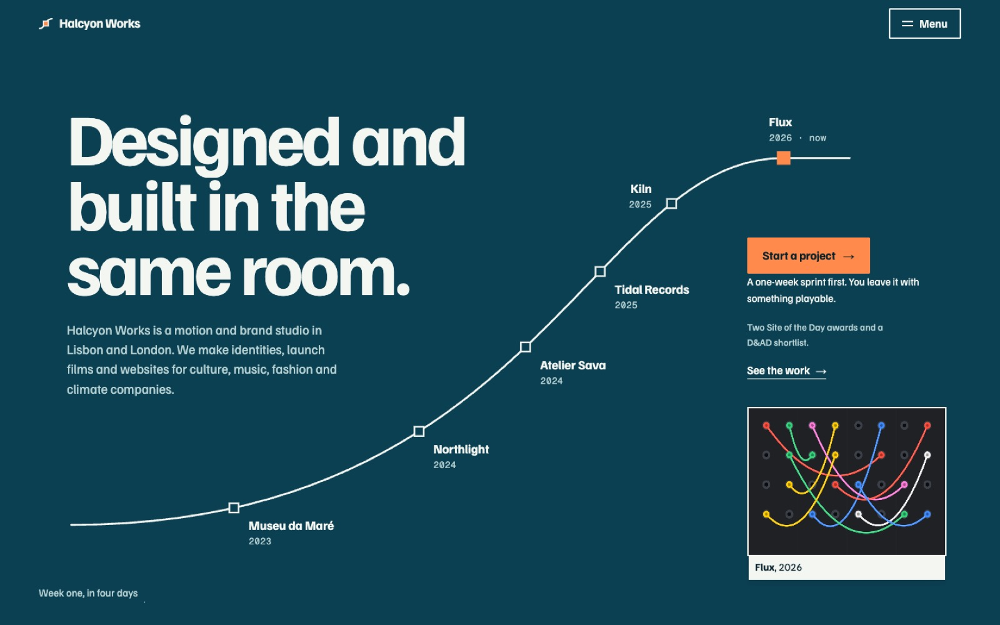
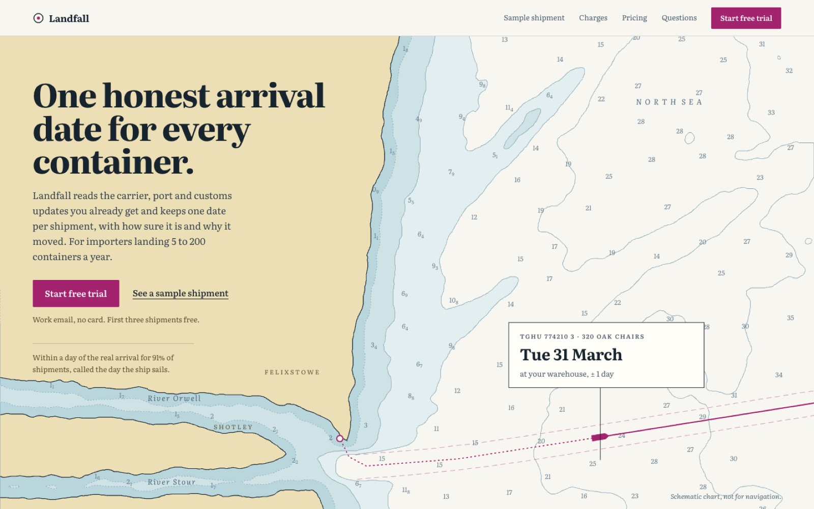
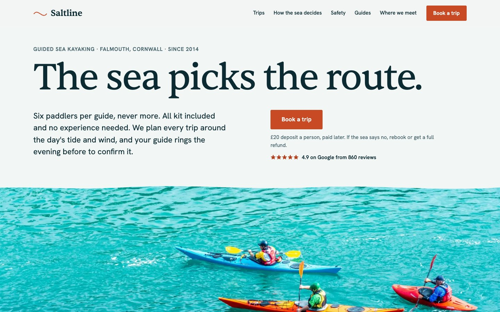
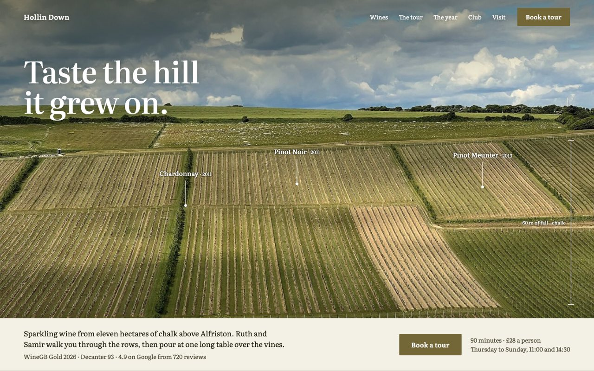
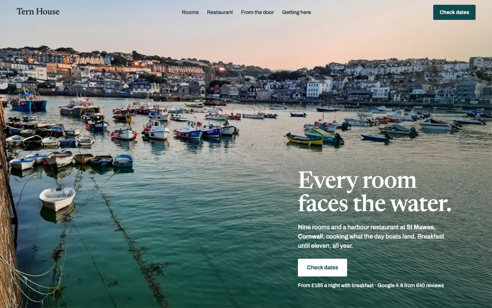
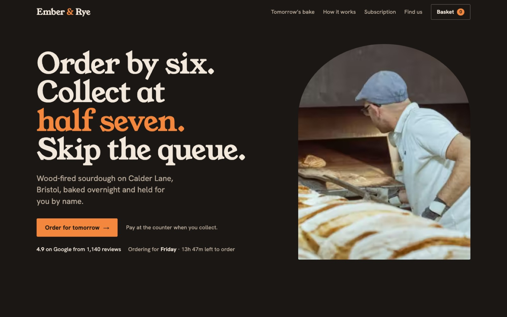

# Argus

The design skill that looks at its own work. Argus makes your coding agent design websites, dashboards and app screens the way a designer does: ask once, show you directions to choose from, build, then look at the real page and fix what it sees.

<!-- EXAMPLES -->
**Examples** (first screens at 1440px). Built with Argus during development; businesses invented.

<table>
<tr><td width="50%"><br><sub>A motion and brand studio (showpiece level): an animator's easing curve carries six projects as keyframes.</sub></td><td width="50%"><br><sub>Freight software: a drawn sea chart, with the one arrival date the product promises pinned on it.</sub></td></tr>
<tr><td width="50%"><br><sub>Guided sea kayaking: one serif headline, the deposit terms beside the button, the paddlers' photograph full width below.</sub></td><td width="50%"><br><sub>A vineyard: a full-bleed photograph of the rows, each block labelled with its grape and year.</sub></td></tr>
<tr><td width="50%"><br><sub>A nine-room harbour hotel: the view from the rooms, with the words on the calm water.</sub></td><td width="50%"><br><sub>A sourdough bakery: the baker at the oven in an arched frame beside the order-for-tomorrow action.</sub></td></tr>
</table>

## Install

In Claude Code, as a plugin:

```
/plugin marketplace add Hamza-Masuadi/argus-skill
/plugin install argus@argus-skill
```

Or into the current project, for Claude Code and the shared `.agents` folder (or the tools it finds there):

```bash
npx argus-skill install
```

Then describe the work as you normally would. You do not need to name the skill:

> Build a landing page for my bakery in Leith. We sell sourdough for collection, and I have photos of the shop.

Other prompts that start it: "add a settings screen", "make this look better", "it looks generic", or a named command such as `polish the pricing section`.

## How a build runs

1. **It says what it will do**, and roughly how long.
2. **It asks once, and waits.** One message, with tappable choices where your tool has them: first a line or two of what it took from your brief, then what only you can decide (what you like and dislike, what would be wrong for you, pictures, how much motion, and anything the brief left open), each with a recommended answer marked. However detailed the brief, it asks; only "don't ask", "just build" or an unattended run skips the questions, and then it lists every answer it assumed.
3. **It deals directions.** From your subject's own things it lists ideas, then `deal.js` deals three directions of different kinds (minimal, picture-led, expressive), each with its own first-screen composition, type pairing, ground and shape, never sharing a structure. It builds the first screen of each, fixes each once, and shows them live on one choosing page. It stops there until you pick or mix; it marks its own recommendation. It never deals a text-beside-picture first screen unless you ask for one.
4. **It builds the first screen alone**, checks it against a written bar, then builds the rest in your project's own stack and components. It builds the motion level you chose: **still** (only controls answer), **moment** for most sites (an arrival, reveals as sections enter, controls that respond, and one choreographed moment made for the subject), **showpiece** for a portfolio, studio, launch, fashion, culture or product-reveal site, or when you ask for an award-style site (smooth scroll, pinned scenes, page transitions, one WebGL layer, one toy, and a preloader only when something real must load), each built from a tested starter and never at the cost of readable content, the keyboard, touch scrolling or reduced motion.
5. **It looks.** Up to three rounds: screenshots at phone and laptop width, a measured check in a real browser, using the page by hand, and a fresh reviewer that names at most three findings and says whether the page got better. A page that moves is also captured in motion: every scroll scene, the arrival and the page transition as contact sheets it reads frame by frame, checked for dead, jumping or flashing steps, with fallbacks (reduced motion, no script, no WebGL, touch) and, for a showpiece, a slowed-down scroll for long frames. It stops when a round does not improve the page and keeps the best round, then makes a **finishing pass** (left-over text, page title and social card, every state, real quotes and dashes, line endings, one motion vocabulary, one stroke and radius family, the footer answering the hero) and takes a final look at four widths.
6. **It reports and remembers**: what it made, checked and assumed, in `DESIGN.md`, plus a small run file in `.argus/` so a long job survives a compacted conversation.

In a project that already has a look, it measures the system your screens really use and builds from that instead of inventing. A one-line tweak gets no ceremony at all.

## Commands

`variants` (directions on a choosing page), `polish` (the final pass), `audit` (a scored, measured check that changes nothing), `typeset`, `colorize`, `animate`, `simplify`.

## Tools

The agent runs these itself; you can too, with `npx argus-skill <tool>` or `node skills/argus/scripts/<tool>.js`.

| Tool | What it does |
|---|---|
| `check <url-or-file>` | Runs 87 checks in a real browser at each width: contrast, overflow, covered content, target sizes, labels, page length, crowded first screens and more. Works on a dev server URL or a built file |
| `shot <url-or-file>` | Screenshots at 320, 390, 1440 and 1920, plus first screens at 768, 820 and 1024, once the page settles, into `shots/<page>/`; `--full`, `--hover`, `--tap`, `--type`, `--frames`, `--scroll-frames`, `--reduced-motion`, `--scheme`. Motion capture as labelled contact sheets: `--scenes`, `--timeline`, `--arrival`, `--transition`, with `--motion-metrics`, `--perf-scroll` (4x CPU slowdown) and `--fallbacks` |
| `inventory <url>` | Measures the design system a page really uses; `--against <url>` lists what a new screen adds |
| `lint <file-or-folder>` | Scans source with 32 rules when nothing can be rendered |
| `rules` | Lists all 123 rules, with severity, tier and source: 33 floor rules that are never waived, the rest prompts to look |
| `deal directions` | Deals directions from the font, hero and section libraries, labelled with the motion level (`--motion still\|moment\|showpiece`, chosen from `--trade` by default); `deal list`, `deal show`, `deal record` |
| `photos "<words>"` | Finds free-licence photographs (Openverse, Wikimedia Commons) and writes `credits.json`; `photos add` and `series` fetch photo pages you picked on Unsplash (Pexels needs `PEXELS_API_KEY`); `sheet`, `sharp`, `palette`, `grade`, `deliver`, `cutout`; `video`, `poster`, `loop` for an optional muted loop |

The effect gallery, `skills/argus/assets/snippets/index.html`, shows the 49 tested effects running; open it in a browser. The showpiece starters, `skills/argus/assets/showpiece/index.html`, are nine working pages (smooth scroll with a pinned scene, split headline, preloader, page transition, WebGL pictures, shader ground, horizontal gallery, kinetic type, a toy).

## Requirements

- Node 22 or later. No runtime dependencies.
- For `shot`, `check`, `inventory` and parts of `photos`: an installed Chrome-family browser (Chrome, Chromium, Edge or Brave), started headless with a throwaway profile. Nothing is downloaded.
- Optional: ffmpeg for `photos loop`; rembg for better `photos cutout`.

## What it touches

- **Network.** Only `photos` makes network calls, and only when run: searches go to `api.openverse.org` and `commons.wikimedia.org`; `photos add` and `series` read the Unsplash or Pexels pages you give them; `api.pexels.com` and `pixabay.com` only when you set `PEXELS_API_KEY` or `PIXABAY_API_KEY`; the museum archives (Europeana, Cleveland, The Met, NASA, Smithsonian) only when named with `--source`; `photos video` searches Mixkit and Commons. Images are then downloaded from those sites' image hosts. `shot` and `check` load the page you point them at, and whatever that page loads. The showpiece starters that use GSAP load it at run time from jsDelivr (`cdn.jsdelivr.net/npm/gsap@3.15.1`, pinned), because GSAP's licence covers use on sites rather than redistribution; offline they show their finished static state. Lenis (MIT) and OGL (Unlicense) are vendored in the package with their licences. The installer, `deal`, `lint` and `rules` make no network calls.
- **Files.** In your project: `.argus/run.md`, `.argus/history.json`, `.argus/rounds/`, `DESIGN.md`, screenshots in `shots/<page>/`, roughs in `.argus/roughs/`, photographs and `credits.json` where you send them. Temporary browser profiles go in the system temp folder and are removed. Nothing is written to your home folder unless you turn on the cross-project history (`deal --global-history`, or `ARGUS_GLOBAL_HISTORY`).
- **Nothing else.** No telemetry, no update checks, no hooks, no settings changed. Nothing is sent anywhere except the search words and page addresses above.

## Other agents

The installer copies the skill into the skill folders of Cursor, Codex and other tools that read `.agents/skills`, Gemini CLI, GitHub Copilot, Kiro, OpenCode, Grok and Devin / Windsurf (`npx argus-skill install --tools=cursor,codex`, `--all`, `--global`, `--dry-run`; `npx argus-skill list` shows every folder). The skill is plain Markdown and the scripts are plain Node, so they run anywhere. What is specific to Claude Code: the plugin install, `${CLAUDE_SKILL_DIR}` in script paths (other agents use the skill's folder), and a subagent for the fresh reviewer (without subagents the review runs in the same thread). Argus is developed and tested in Claude Code on macOS; reports from other tools are welcome in the [issues](https://github.com/Hamza-Masuadi/argus-skill/issues).

## Credits

Named after Argus Panoptes, the hundred-eyed watchman of Greek myth. Written from scratch, drawing on established design research (Laws of UX, Nielsen Norman Group, WCAG 2.2, the Apple and Material guidelines) and on lessons from studying other design skills.

Created by Hamza Masuadi (Hamzawee), co-authored with Claude (Anthropic). See the [changelog](CHANGELOG.md) for what changed.

## Licence

MIT. See [LICENSE](LICENSE).
